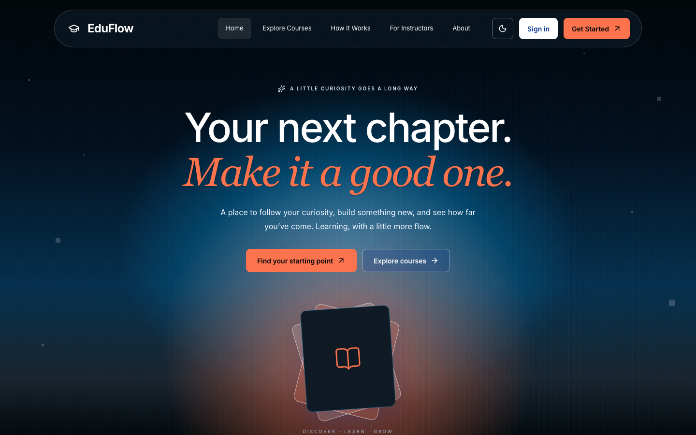
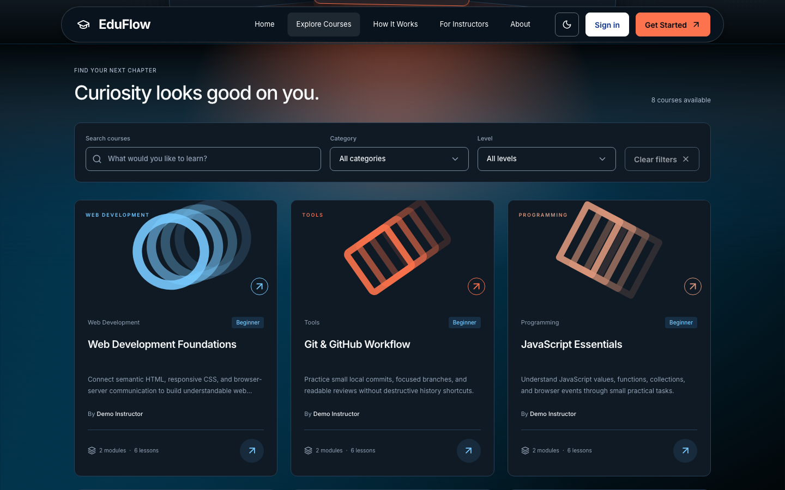
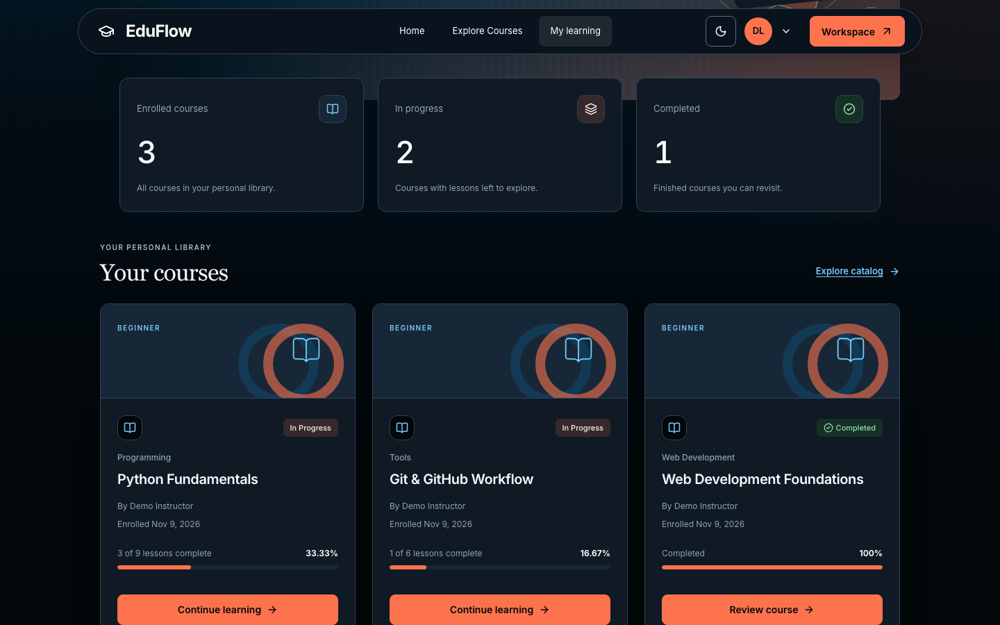
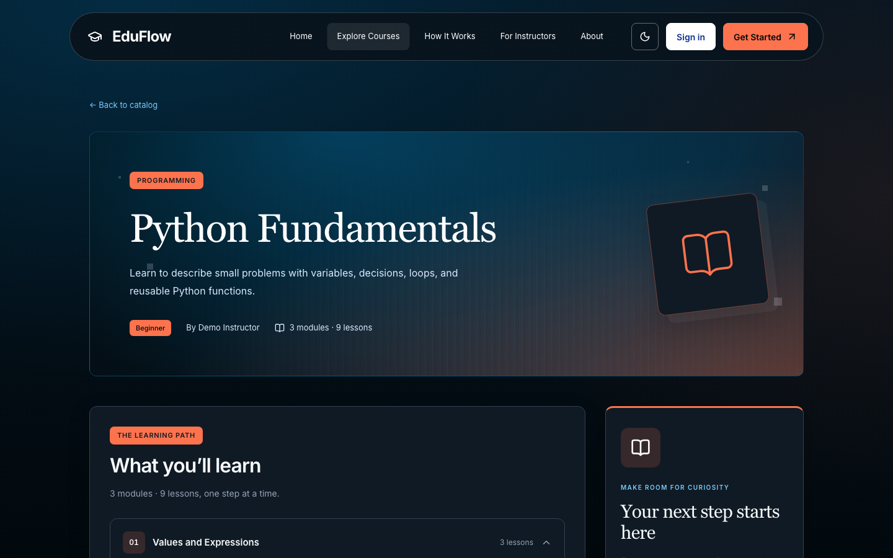
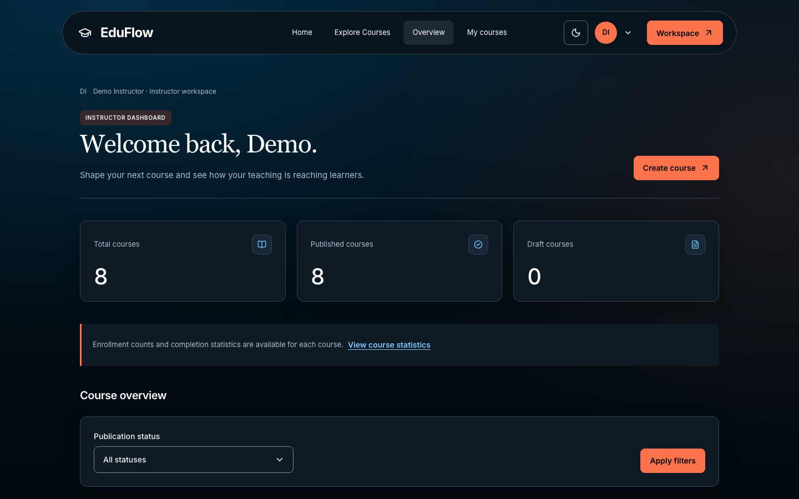
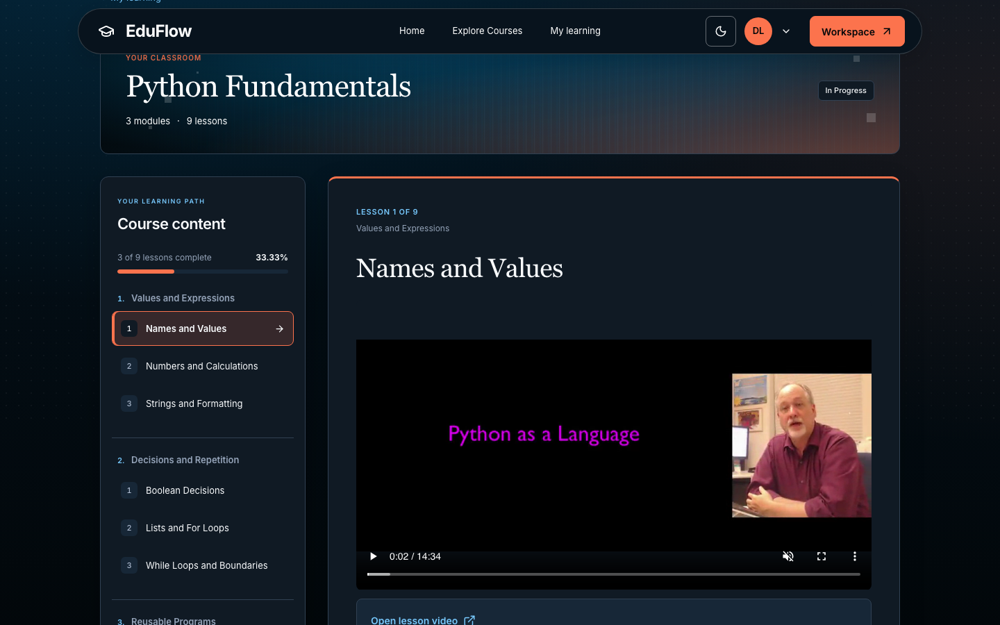
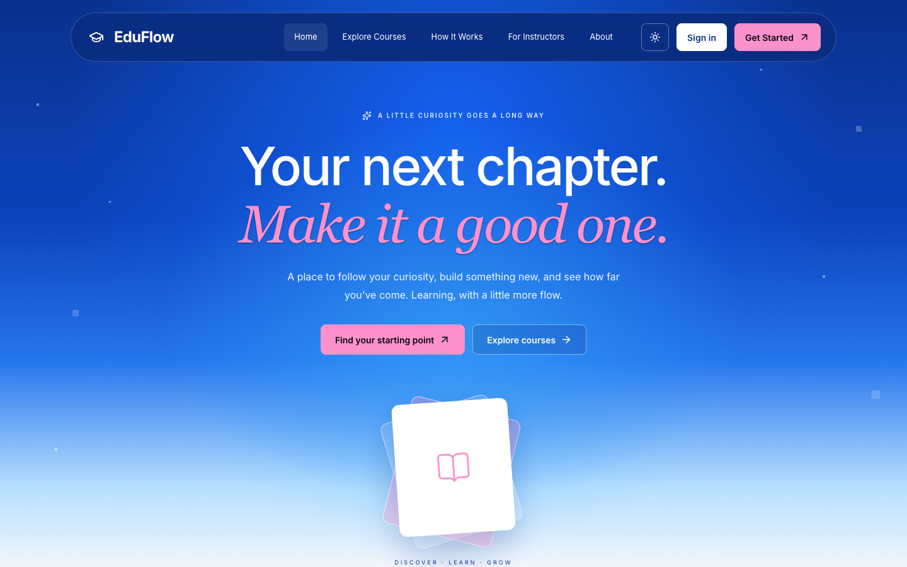
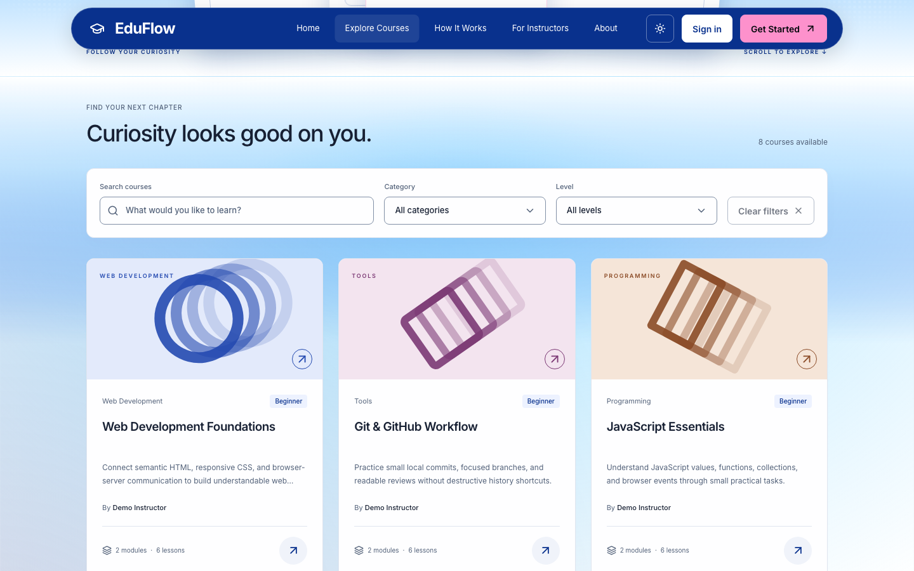
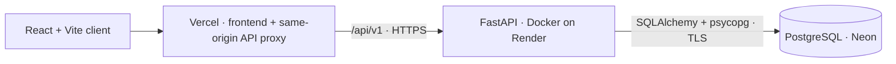

# EduFlow LMS

## Overview

EduFlow is a full-stack learning management system for discovering courses, learning through structured lessons, and publishing curriculum. It combines a responsive React application with a FastAPI modular monolith and PostgreSQL.

Built as a portfolio project, EduFlow demonstrates complete student, instructor and administrator workflows backed by real API data, explicit authorization and database integrity rules.

## Live Demo

**[Explore EduFlow](https://eduflow-lms.tech)** · [Source code](https://github.com/ga1ssaa/eduflow-lms)

The primary production URL is **https://eduflow-lms.tech**. The [Vercel provider URL](https://eduflow-lms-topaz.vercel.app) is retained for operational reference. The portfolio is deployed on Vercel, Render and Neon. The backend can sleep when inactive, so the first API request may take longer or need a retry. Current working-branch polish and screenshots may precede publication to the live deployment.

Registration creates a student account. Instructor and administrator access require explicitly provisioned accounts; no shared credentials or default privileged account are published.

## Features

### Student

- Register, sign in, and restore a session after reloading.
- Browse published courses with title search, category and level filters, incremental loading and a manual Load More fallback.
- Review course details and curriculum, enroll, and access protected lessons.
- Read lesson content, watch optional external videos, and mark lessons complete or incomplete.
- Use the Student Dashboard to track enrolled, in-progress and completed courses with progress calculated from actual lesson records.
- Enter courses through **Start Learning**, **Continue Learning** or **Review Course**, according to saved progress.

### Instructor

- Manage owned content from the Instructor Dashboard.
- Create and edit owned courses, modules and lessons, including text and external video links.
- Order curriculum, publish or unpublish courses, and delete eligible drafts.
- Review course enrollment, learner progress and course-level statistics.
- Keep unsaved input through failed saves, with navigation warnings and explicit conflict feedback.

### Admin

- Review the full course catalog, including drafts, with real publication counts and filters.
- Inspect course content and moderate publication under the same server-side validation rules.
- Access authorized course-management views. User and role management are outside the implemented UI/API.

### UI

- Responsive public discovery pages and role-specific learning/authoring workspaces.
- Light, Dark and System themes with coordinated Sunrise/Sunset Hero transitions.
- Cinematic scroll reveals with reduced-motion support.
- A shared responsive footer and consistent role-aware navigation.
- Keyboard-accessible controls, visible focus, contextual loading, empty and error states.
- Session recovery and role-aware navigation without exposing private lesson content publicly.

## Screenshots

Captured at **1440 × 900** from the current local portfolio build, using fictitious accounts and seeded courses in disposable local PostgreSQL. Enrollment and progress come from real API records, not production data; the shown revision may be newer than the live site.

### Home Page



### Explore Courses



### Student Dashboard



<details>
<summary>View More Screenshots</summary>

### Course Details · Dark



### Instructor Dashboard · Dark



### Learning Experience · Dark



### Home · Light



### Course Catalog · Light



</details>

## Architecture



The backend is a synchronous modular monolith with separate authentication, course and learning modules. HTTP routers validate contracts, services enforce business rules and transaction boundaries, repositories encapsulate queries, and request-scoped sessions access PostgreSQL. Alembic manages explicit schema changes.

Course ownership, publication state and enrolled-student access are checked on the server. Unique constraints, foreign keys, row locks and learning-integrity triggers protect enrollment and completion records. Progress is derived from current lessons rather than stored as a second mutable total.

The browser calls the relative `/api/v1` URL. Vercel proxies API requests to Render while retaining the frontend origin for refresh cookies. Local Vite provides the equivalent development proxy.

## Tech Stack

| Area                | Technology                                                           |
| ------------------- | -------------------------------------------------------------------- |
| Frontend            | React 19, TypeScript, Vite 8, React Router 7                         |
| UI and server state | Tailwind CSS 4, shared CSS components, Lucide, TanStack Query 5      |
| Backend             | Python 3.12+, FastAPI, Pydantic 2, Uvicorn                           |
| Persistence         | PostgreSQL 17, SQLAlchemy 2 synchronous sessions, psycopg 3, Alembic |
| Authentication      | JWT access tokens, rotating refresh sessions, Argon2id               |
| Verification        | pytest, Ruff, Vitest, Testing Library, Playwright, ESLint, Prettier  |
| Infrastructure      | Docker Compose, GitHub Actions, Vercel, Render, Neon                 |

Python 3.13 and Node.js 24 are used by the container/CI and frontend CI respectively. Dependencies are locked separately for the backend and frontend.

## Deployment

The portfolio uses **Vercel Hobby** for the frontend and same-origin `/api/v1` proxy, **Render Free** for the Docker API, and **Neon Free** for PostgreSQL. Cold starts and external video availability affect the demo experience.

Production setup uses private environment settings, explicit trusted HTTPS origins and a pooled runtime database URL. Remote schema changes use a separately approved **DIRECT** database connection. See the [deployment guide](docs/deployment.md) for environment configuration, API rewrites, migrations and release verification, and [Demo videos](docs/demo-videos.md) for external-media details. Provider limits and live settings require independent verification; no pricing or quota is assumed here.

## Local Development

Requirements: Git, Docker with Compose, Python 3 for one-time secret generation, and Node.js 24 LTS with npm. These steps target a fresh **local development** database only.

### 1. Clone and configure

```sh
git clone https://github.com/ga1ssaa/eduflow-lms.git
cd eduflow-lms
cp .env.example .env
```

On an existing checkout, preserve its `.env` instead of overwriting it. Generate the signing secret directly into that ignored file without printing it; an existing nonempty secret is retained:

```sh
python3 - <<'PY'
from pathlib import Path
import secrets

path = Path('.env')
content = path.read_text()
if not any(line.startswith('JWT_SECRET=') and line.partition('=')[2].strip()
           for line in content.splitlines()):
    content = '\n'.join(line for line in content.splitlines()
                        if not line.startswith('JWT_SECRET='))
    path.write_text(content + '\nJWT_SECRET=' + secrets.token_urlsafe(48) + '\n')
path.chmod(0o600)
PY
```

Example database credentials are local placeholders. Do not reuse them for a shared deployment or commit a real `.env`.

### 2. Start the API and apply local migrations

```sh
docker compose up --build -d --wait
docker compose exec backend alembic upgrade head
docker compose exec backend alembic current
curl --fail http://127.0.0.1:8000/api/v1/health
curl --fail http://127.0.0.1:8000/api/v1/health/db
```

Both health checks return `{"status":"ok"}`. The API is at <http://127.0.0.1:8000>; interactive documentation is at <http://127.0.0.1:8000/docs>. PostgreSQL stays inside the Compose network, with a persistent named volume. Migrations never run automatically at application startup; do not remove database volumes to resolve configuration issues.

### 3. Start the frontend

In another terminal, from the cloned repository root:

```sh
cd frontend
npm ci
npm run dev
```

Open <http://127.0.0.1:5173>. No frontend environment file is required. Stay on the same hostname for cookie-based session recovery. Optional public settings and backend-only local development are explained in the [development guide](docs/development.md).

The database starts without accounts or courses. Register a student through the UI; explicitly provision privileged local accounts and inspect the demo seed before applying it, following the development guide.

## Demo Content

The original manifest contains **8 courses, 21 modules and 63 lessons** with explanations, examples and exercises. It uses deterministic identities and does not create accounts or run at startup. These courses supplement the catalog; they are not a product limit.

Three supplementary **CC BY 3.0** videos with plaintext attribution are confirmed attached to the production demo lessons:

- Python Fundamentals → **Names and Values**.
- Git & GitHub Workflow → **Focused Commits**.
- Web Development Foundations → **Semantic HTML**.

Media sources, caption limitations and guarded maintenance procedures are documented in [Demo videos](docs/demo-videos.md). Attachment status does not establish current external playback availability.

## Security

- Short-lived JWT access tokens stay in memory; rotating refresh tokens use HttpOnly cookies. Production settings require Secure cookies, scoped to auth routes; only refresh-token hashes are stored.
- Passwords use Argon2id. Public registration always creates students; current active roles and course ownership are enforced server-side.
- Auth POST requests require an exact trusted Origin and `X-CSRF-Token: 1`; CORS uses explicit origins. The hosted same-origin proxy preserves cookie and CSRF behavior.
- Production setup requires HTTPS origins and TLS-enabled Neon connection settings; live configuration is verified separately. Secrets remain outside tracked files and frontend bundles.

Configuration and operational details are in [Development](docs/development.md#authentication-and-local-accounts) and [Deployment](docs/deployment.md).

## Testing

Frontend checks:

```sh
cd frontend
npm run check
npm run lint
npm run format:check
npm test
npm run build
```

Backend checks, from the repository root:

```sh
cd backend
uv sync --locked
uv run python -m pytest
uv run ruff check .
uv run ruff format --check .
```

The repository's unit/component, isolated PostgreSQL and optional browser suites cover:

- Student learning, instructor authoring and admin publication workflows.
- Authentication/session recovery, enrollment, completion and derived progress.
- Video controls, loading/error recovery and unsafe media URL rejection.
- Responsive layouts, navigation, reduced motion and theme/reveal lifecycles.
- Migration consistency, authorization and database integrity rules.

Media-error checks use controlled fixtures; they do not prove successful playback from an external host. Database and fixture-dependent tests require their documented private environments and may skip without them. CI runs backend migrations/tests and frontend checks/build; see [test setup and isolation](docs/development.md#backend-development-and-isolated-tests) for prerequisites.

## Project Status and Limitations

The portfolio is deployed and the core catalog, authentication, authoring, enrollment, learning and moderation workflows are implemented. Current working-branch visual and documentation polish awaits publication; local screenshots can be newer than the live site.

- Sleeping backend/database services can delay initial requests. Free-tier availability depends on provider limits; no uptime guarantee is made.
- Videos are externally hosted; delivery and continued availability depend on the source. Integrated caption tracks are not implemented, so prerecorded-media accessibility is incomplete.
- `support@eduflow.example` is a reserved demo address, **not a working support inbox**. A real contact address can be configured separately.
- Payments, certificates, quizzes, messaging, video hosting, user/role management and unenrollment are outside the implemented scope.

## Documentation

- [Development guide](docs/development.md): local accounts, API contracts, demo curriculum and isolated verification.
- [Deployment guide](docs/deployment.md): hosting configuration, proxy/cookie behavior and approval-gated remote maintenance.
- [Demo videos](docs/demo-videos.md): media attribution, confirmed production attachments and guarded maintenance procedures.
- [Project specification](PROJECT_SPEC.md): domain rules, delivery phases and scope.
- [Design system](DESIGN_SYSTEM.md): themes, components, motion and accessibility conventions.
